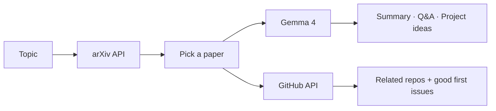

# 📄 PaperPilot

**From research paper to open-source contribution.**


PaperPilot helps students and developers find the latest research on any topic, understand it in minutes, ask follow-up questions, and turn it into a project, using open-weight **Gemma 4**.

🔗 **Live app:** https://paperpilot-resarch-paper.streamlit.app

## Screenshots
<table>
  <tr>
    <td width="50%"><b>Instant summaries</b><br></td>
    <td width="50%"><b>Project ideas from any paper</b><br></td>
  </tr>
</table>

## The problem
Research papers are hard to find, dense to read, and rarely lead anywhere practical. Students juggle a search engine, PDFs, a chatbot and GitHub just to get from "interesting paper" to "something I can build."

## What it does
| Feature | Description |
|---|---|
| 🔎 Search | Find papers on arXiv by topic, sorted by latest or most relevant |
| 📝 Summaries | Beginner, Student or Expert level, with a downloadable copy |
| 💬 Follow-ups | Ask questions about the selected paper |
| 💡 Project ideas | 3 weekend-sized projects based on the paper |
| 🔗 Code finder | Repos that cite the paper (or the closest matches), with links to their "good first issues" |

## How it works


## Why PaperPilot
- **One workflow instead of five tabs:** search, understand, ask, build, and contribute in one place.
- **Open-weight model:** built on Gemma 4, with an automatic fallback between `gemma-4-26b-a4b-it` and `gemma-4-31b-it`.
- **Grounded answers:** prompts keep the model to the paper's text and tell it to say so when something isn't stated.
- **Connects reading to open source:** it points you from a paper to code you can actually contribute to, which fits the spirit of Hacktoberfest.

## Built with
- **Gemma 4** via the Gemini API
- **Streamlit** for the UI
- **arXiv API** for papers
- **GitHub API** for related repositories

## Run locally
```bash
git clone https://github.com/ParthBhuptani/paperpilot.git
cd paperpilot
pip install -r requirements.txt
```
Create a `.env` file:
```
GEMINI_API_KEY=your_key_here
GITHUB_TOKEN=optional_github_token
```
Get a free key at https://aistudio.google.com/apikey, then run:
```bash
python -m streamlit run app.py
```

## Limitations
- Summaries and answers are based on each paper's **abstract and metadata**, not the full PDF.
- Very new papers often have no public code yet, so the code finder may return nothing or only loose matches.
- It uses the free Gemini API tier, so heavy use may hit rate limits.

## Roadmap
- [ ] Full-PDF reading for deeper answers
- [ ] Side-by-side paper comparison
- [ ] Fully local mode with Ollama

## Hackathon
Built at **Hacktoberfest Hack Day Ahmedabad x Open Source Weekend**.
Categories: Best Open-Source AI Project · Best Use of Gemma 4

## Author
**Parth Bhuptani** · [GitHub](https://github.com/ParthBhuptani) · [Portfolio](https://parthbhuptani.vercel.app)
