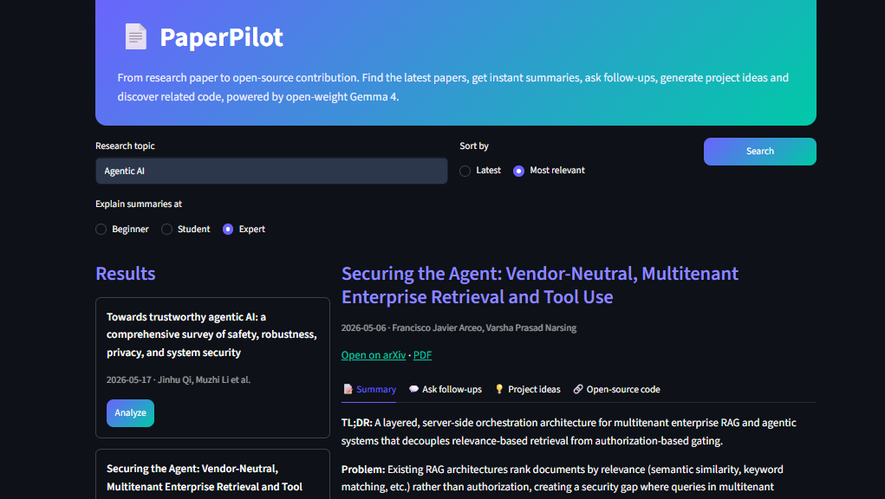
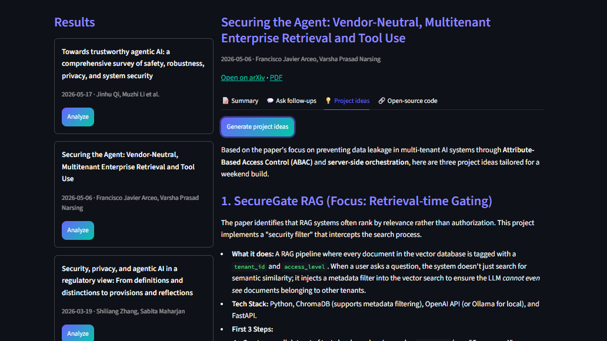

# 📄 PaperPilot

**From research paper to open-source contribution.**

PaperPilot helps students and developers find the latest research on any topic, understand it in minutes, ask follow-up questions, and turn it into a project, using open-weight **Gemma 4**.

🔗 **Live app:** https://paperpilot-resarch-paper.streamlit.app

## Screenshots



## The problem
Research papers are hard to find, dense to read, and rarely lead anywhere practical. Students end up juggling a search engine, PDFs, a chatbot, and GitHub just to get from "interesting paper" to "something I can build."

## What it does
- 🔎 **Search arXiv by topic**, sorted by latest or most relevant
- 📝 **Instant summary** of any paper at Beginner, Student, or Expert level, with a downloadable copy
- 💬 **Ask follow-up questions** about the selected paper
- 💡 **Project ideas:** 3 weekend-sized projects based on the paper
- 🔗 **Open-source code finder:** repositories that cite the paper (or the closest matches), with direct links to their "good first issues" so you can start contributing

## Built with
- **Gemma 4** (open-weight model) via the Gemini API (`gemma-4-26b-a4b-it`, with `gemma-4-31b-it` as automatic fallback)
- **Streamlit** for the UI
- **arXiv API** for papers
- **GitHub API** for related repositories

## Run locally
```bash
git clone https://github.com/ParthBhuptani/paperpilot.git
cd paperpilot
pip install -r requirements.txt
```
Create a `.env` file:
```
GEMINI_API_KEY=your_key_here
GITHUB_TOKEN=optional_github_token
```
Get a free key at https://aistudio.google.com/apikey, then run:
```bash
python -m streamlit run app.py
```

## Limitations
- Summaries and answers are based on each paper's **abstract and metadata**, not the full PDF.
- Very new papers often have no public code yet, so the code finder may return nothing or only loose matches.
- It uses the free Gemini API tier, so heavy use may hit rate limits.

## Roadmap
- Full-PDF reading for deeper answers
- Side-by-side paper comparison
- Running fully locally with Ollama

## Hackathon
Built at **Hacktoberfest Hack Day Ahmedabad x Open Source Weekend**.
Categories: Best Open-Source AI Project · Best Use of Gemma 4

## Author
**Parth Bhuptani** · [GitHub](https://github.com/ParthBhuptani) · [Portfolio](https://parthbhuptani.vercel.app)
